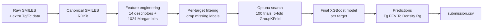

# 🧪 NeurIPS Open Polymer Prediction 2025: RDKit + XGBoost

Predicting five key polymer properties (**Tg, FFV, Tc, Density, Rg**) directly from **SMILES** strings, using RDKit molecular features and per-target **XGBoost** models tuned with **Optuna**. Built for the **NeurIPS - Open Polymer Prediction 2025** Kaggle competition.

---

## 📑 Table of Contents

1. [Overview](#-overview)
2. [Problem Statement](#-problem-statement)
3. [Approach at a Glance](#-approach-at-a-glance)
4. [Dataset](#-dataset)
5. [Methodology](#-methodology)
6. [Results](#-results)
7. [Configuration Reference](#-configuration-reference)

---

## 🔭 Overview

Polymers are everywhere, from packaging and membranes to electronics and aerospace materials. Measuring their properties in a lab is slow and costly, so predicting them from molecular structure can speed up the search for better materials.

This project is a complete, reproducible machine learning pipeline that goes from raw SMILES text to a Kaggle-ready `submission.csv`:

- Cleans and **canonicalises** SMILES strings with RDKit.
- Expands the training pool with **supplementary Tg and Tc datasets**.
- Generates **1,038 numerical features** per molecule (14 RDKit descriptors + 1,024 Morgan fingerprint bits).
- Trains a **separate XGBoost model for each target**, with hyperparameters found by **Optuna** under **grouped cross-validation**.

---

## 🎯 Problem Statement

**Input:** a polymer repeat unit written as a SMILES string (for example `*CC(*)c1ccccc1C(=O)OCCCCCC`, where `*` marks the connection points).
**Output:** five continuous property values.

| Target | Property | Why it matters |
|---|---|---|
| **Tg** | Glass transition temperature | Temperature at which chains shift from rigid to flexible; governs mechanical behaviour across temperatures |
| **FFV** | Fractional free volume | Unoccupied space between chains (unitless, 0 to 1); drives gas permeability and molecular mobility |
| **Tc** | Thermal conductivity | Ability to transfer heat; key where heat management matters |
| **Density** | Mass per unit volume | Indicates how tightly chains pack; affects physical and mechanical properties |
| **Rg** | Radius of gyration | Size of the polymer coil, as the root-mean-square distance of segments from the centre of mass |

Challenges addressed:

- **Sparse labels:** most molecules have only some of the five targets measured, so each target has a different number of samples.
- **Structural duplicates:** the same polymer can be written as several SMILES strings, which would leak between train and validation folds.
- **Text input:** models need numbers, so structure must be turned into informative features.

---

## ⚡ Approach at a Glance

1. **Canonicalise** SMILES so identical structures share one representation.
2. **Featurise** with RDKit descriptors and binary Morgan fingerprints.
3. **Tune** XGBoost per target with Optuna, scoring by MAE under grouped CV.
4. **Train** on all available data for each target and save models as JSON.
5. **Predict** the test set and assemble the submission.

---

## 📊 Dataset

The main data comes from the **NeurIPS - Open Polymer Prediction 2025** competition (`train.csv`, `test.csv`). the community datasets supply extra measurements, mainly for Tg and Tc.

### Sources

| Source | File | Role |
|---|---|---|
| Competition data | `train.csv`, `test.csv` | Core training and test sets |
| Extra Tc data | `Tc_SMILES.csv` | Additional thermal conductivity measurements |
| Extra Tg data | `TgSS_enriched_cleaned.csv` | Additional glass transition measurements |
| Pre-merged extra data | `SMILES_EXTRA_DATA (1).csv` | Combined supplementary file used for training in the final run |

### Data volumes observed in the notebook

| Item | Count |
|---|---|
| Original training rows | **7,973** |
| Supplementary rows added | **1,305** |
| Total training rows | **9,278** |
| Test rows | **3** (the public sample; the full test set is hidden) |
| Features per molecule | **1,038** |

### Labelled samples per target

| Target | Samples with a label |
|---|---|
| FFV | 7,043 |
| Tg | 1,159 |
| Density | 1,146 |
| Tc | 866 |
| Rg | 614 |

FFV is by far the best covered target. Rg is the scarcest, which is reflected in its harder cross-validation error below.

### Sample of the training data

| id | SMILES | Tg | FFV | Tc | Density | Rg |
|---|---|---|---|---|---|---|
| 87817 | `*CC(*)c1ccccc1C(=O)OCCCCCC` | NaN | 0.3746 | 0.2057 | NaN | NaN |
| 106919 | `*Nc1ccc([C@H](CCC)c2ccc(C3(c4ccc([C@@H](CCC)c5...` | NaN | 0.3704 | NaN | NaN | NaN |
| 388772 | `*Oc1ccc(S(=O)(=O)c2ccc(Oc3ccc(C4(c5ccc(Oc6ccc(...` | NaN | 0.3789 | NaN | NaN | NaN |

---

## 🧠 Methodology

### 1. SMILES canonicalisation

`get_canonical_smiles` converts each SMILES into RDKit's canonical form, falling back to the original string if parsing fails. This matters because the **canonical SMILES is used as the group key for cross-validation**: structurally identical polymers always stay in the same fold, which prevents leakage between training and validation sets.

### 2. Combining extra data

Supplementary rows are given fresh, non-colliding IDs, aligned to the original column order, and concatenated with the training set. Missing target columns are left as `NaN`, and each target model later uses only the rows that have a label for it.

### 3. Feature engineering with RDKit

Each molecule becomes a vector of **1,038 features**:

| Group | Features |
|---|---|
| 📏 Size and structure | Molecular weight, heavy atom count, ring count, aromatic ring count |
| 🌀 Flexibility and complexity | Rotatable bonds, BertzCT index, BalabanJ index |
| ⚡ Polarity | LogP, topological polar surface area (TPSA), H-bond donors, H-bond acceptors |
| 🧪 Functional groups | Ether, ester and amide counts |
| 🔢 Fingerprint | **1,024-bit Morgan (ECFP) fingerprint**, radius 2 |

Molecules RDKit cannot parse are skipped safely and excluded from the feature table.

### 4. Hyperparameter optimisation with Optuna

For every target, Optuna runs **100 trials** using the TPE sampler (seed 42). Each trial is scored by the mean validation MAE over **5-fold GroupKFold**.

| Hyperparameter | Search range |
|---|---|
| `learning_rate` | 0.01 to 0.1 (log scale) |
| `max_depth` | 5 to 20 |
| `subsample` | 0.6 to 1.0 |
| `colsample_bytree` | 0.6 to 1.0 |
| `gamma` | 1e-8 to 1.0 (log scale) |
| `reg_alpha` | 1e-8 to 1.0 (log scale) |
| `reg_lambda` | 1e-8 to 2.0 (log scale) |
| `min_child_weight` | 1 to 10 |

Base XGBoost settings: `reg:squarederror` objective, MAE evaluation metric, GPU histogram tree method, up to 10,000 boosting rounds with 100 rounds of early stopping during tuning.

### 5. Target-specific training

A **dedicated model per target** is trained as follows:

1. Keep only rows where that target is present.
2. Run the Optuna search with grouped cross-validation.
3. Train the final model on **all** rows available for that target using the best parameters.
4. Save it to `models/<target>_model.json` for reuse without retraining.

### 6. Prediction and submission

Each saved model predicts on the test feature matrix, and the outputs are combined into a CSV with the columns `id, Tg, FFV, Tc, Density, Rg`.

---

## 📈 Results

### Cross-validation performance

Errors are **Mean Absolute Error (MAE)** in each target's own units. **CV MAE** is the best Optuna trial's mean over 5 grouped folds, so it is the honest estimate of generalisation. **Train MAE** is measured on the data the final model was fit on.

| Target | Samples | CV MAE | Train MAE |
|---|---|---|---|
| **Tg** | 1,159 | 35.7923 | 0.1659 |
| **FFV** | 7,043 | 0.0059 | 0.0010 |
| **Tc** | 866 | 0.0314 | 0.0051 |
| **Density** | 1,146 | 0.0443 | 0.0005 |
| **Rg** | 614 | 1.5873 | 0.1462 |

### Sample predictions

Predictions for the three public test rows:

| id | Tg | FFV | Tc | Density | Rg |
|---|---|---|---|---|---|
| 1109053969 | 216.219 | 0.3713 | 0.2036 | 1.1276 | 23.638 |
| 1422188626 | 169.307 | 0.3777 | 0.2445 | 1.1158 | 21.128 |
| 2032016830 | 92.218 | 0.3509 | 0.2404 | 1.0495 | 19.497 |

All predicted values fall in physically plausible ranges (FFV between 0 and 1, density near 1 g/cm³ for common polymers).

### Leaderboard

> Fill in your own numbers from Kaggle.

| Metric | Value |
|---|---|
| Public leaderboard score | _your value_ |
| Private leaderboard score | _your value_ |
| Rank | _your value_ |

### Reading the results

- **FFV** is the strongest target, helped by having the most labelled samples (7,043) and a narrow value range.
- **Tg** has the largest absolute CV error. Tg values span a wide temperature range and only 1,159 samples are labelled, so this is the main target to improve.
- **Rg** has the fewest samples (614), which limits how well the model can generalise.
- The large gap between **Train MAE and CV MAE** on every target shows the final models fit their training data very closely. See the limitations section for how to narrow it.

---

## ⚙️ Configuration Reference

| Parameter | Default | Description |
|---|---|---|
| `RANDOM_STATE` | 42 | Seed for XGBoost and Optuna |
| `USE_GPU` | True | Use GPU histogram training |
| `GPU_ID` | 0 | GPU device index |
| `N_FOLDS` | 5 | Number of GroupKFold splits |
| `MAX_ITERATIONS` | 10000 | Maximum boosting rounds |
| `EARLY_STOPPING` | 100 | Early stopping patience during tuning |
| `OPTUNA_TRIALS` | 100 | Trials per target |
| `VERBOSE_EVAL` | 100 | Logging interval for the final fit |
| `TARGET_COLUMNS` | Tg, FFV, Tc, Density, Rg qm| Properties to predict |
| `STUDY_DIR` | `studies/` | Folder for Optuna studies |
| `MODEL_DIR` | `models/` | Folder for saved models |
| `radius` / `n_bits` | 2 / 1024 | Morgan fingerprint settings |

---

